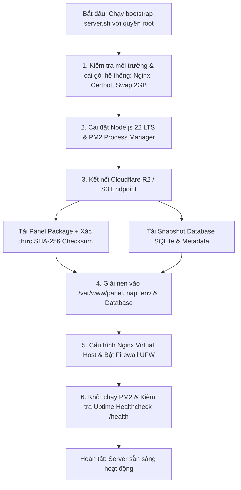

# MNV Server Scripts

Bộ script tự động hóa khởi tạo máy chủ (Server Provisioning & Disaster Recovery) chuẩn Production dành cho hệ sinh thái **MNV Panel**. Hỗ trợ dựng mới toàn bộ hạ tầng VPS/Server và khôi phục nguyên vẹn hiện trạng (toàn bộ cấu hình, database, domain và phiên bản ứng dụng) từ Cloudflare R2 Object Storage chỉ với một lệnh duy nhất.

---

## 🌟 Tính Năng Nổi Bật

- **Tính Bất Biến & Chạy Lại An Toàn (Idempotent):** Có thể chạy lại nhiều lần mà không làm hỏng cấu hình hiện có hay gây xung đột dịch vụ.
- **Tự Động Cài Đặt Gói Cốt Lõi:** Thiết lập tự động Node.js 22 LTS, PM2, Nginx, Certbot SSL, cấu hình Swap 2GB và tinh chỉnh `vm.swappiness=10`.
- **Khôi Phục Trạng Thái (Zero-Loss Recovery):** Tải bản phát hành (release archive) và snapshot database SQLite từ Cloudflare R2, tự động xác thực tính toàn vẹn qua mã băm SHA-256.
- **Cấu Hình Nginx & Tường Lửa Tự Động:** Tự sinh Nginx Reverse Proxy tối ưu hóa, cấu hình UFW bảo vệ các cổng 22, 80, 443 và cổng quản trị.
- **Sẵn Sàng Triển Khai Blue/Green:** Tạo sẵn cấu trúc thư mục `/var/www/app/releases/{blue,green}` và `/var/www/app/shared` phục vụ Zero-Downtime Deployment.

---

## 🏗️ Sơ Đồ Kiến Trúc Hoạt Động



---

## 📋 Yêu Cầu Hệ Thống

| Thành Phần | Yêu Cầu Tối Thiểu | Khuyến Nghị |
| :--- | :--- | :--- |
| **Hệ Điều Hành** | Ubuntu 22.04 LTS (Jammy) | Ubuntu 24.04 LTS (Noble) |
| **Quyền Thực Thi** | `root` hoặc người dùng có quyền `sudo -E` | `root` |
| **Bộ Nhớ (RAM)** | 1 GB RAM (script tự tạo thêm 2GB Swap) | 2 GB RAM trở lên |
| **Lưu Trữ Ngoài** | Cloudflare R2 Bucket chứa bản build panel | R2 Bucket phân quyền tối thiểu (Least Privilege) |

---

## ⚙️ Cấu Hình Biến Môi Trường

Sao chép file mẫu `.env.example` hoặc truyền trực tiếp trước khi thực thi:

### Biến Bắt Buộc

| Biến | Ý Nghĩa & Ví Dụ |
| :--- | :--- |
| `R2_ACCOUNT_ID` | Account ID tài khoản Cloudflare của bạn. |
| `R2_ACCESS_KEY_ID` | R2 API Token Access Key ID có quyền đọc/ghi bucket. |
| `R2_SECRET_ACCESS_KEY` | R2 API Token Secret Access Key tương ứng. |
| `R2_BUCKET_NAME` | Tên Bucket lưu trữ bản phát hành và dữ liệu backup của MNV Panel. |

### Biến Tùy Chọn

| Biến | Mặc Định | Mô Tả |
| :--- | :--- | :--- |
| `PANEL_DOMAIN` | `""` | Tên miền cho panel (vd: `panel.example.com`). Nếu bỏ trống, panel lắng nghe qua `http://<IP>:4000`. |
| `PANEL_PORT` | `4000` | Cổng HTTP mà tiến trình panel lắng nghe cục bộ. |
| `PANEL_SHA` | `latest` | Commit SHA cụ thể của bản release panel cần kéo về. |
| `STATE_KEY` | Auto detect | Đường dẫn snapshot cụ thể trên R2 (vd: `backups/panel/2026-03-01.sqlite.gz`). |
| `FRESH` | `0` | Nếu đặt `1`: Bỏ qua khôi phục snapshot database, khởi tạo panel trắng mới hoàn toàn. |
| `R2_ENDPOINT` | Cloudflare | Endpoint tương thích S3 tùy biến (dùng khi chạy với MinIO, AWS S3,...). |

---

## 🚀 Hướng Dẫn Triển Khai

### Cách 1: Sử dụng file `.env` (An toàn & Khuyên dùng)

Script sẽ **tự động nạp cấu hình** nếu phát hiện file `.env` nằm cùng thư mục:

```bash
# 1. Tải script về máy chủ và cấp quyền
curl -fsSL https://raw.githubusercontent.com/kayandk/mnv-server-scripts/main/bootstrap-server.sh -o bootstrap-server.sh
chmod +x bootstrap-server.sh

# 2. Tạo file .env chứa thông tin cấu hình R2
cat > .env <<'EOF'
R2_ACCOUNT_ID=your_account_id
R2_ACCESS_KEY_ID=your_access_key
R2_SECRET_ACCESS_KEY=your_secret_key
R2_BUCKET_NAME=your_bucket
PANEL_DOMAIN=panel.example.com
EOF

# 3. Chạy trực tiếp với quyền root (tự động nạp file .env)
sudo ./bootstrap-server.sh
```

### Cách 2: Truyền biến môi trường trực tiếp

```bash
sudo R2_ACCOUNT_ID="your_account_id" \
     R2_ACCESS_KEY_ID="your_access_key" \
     R2_SECRET_ACCESS_KEY="your_secret_key" \
     R2_BUCKET_NAME="your_bucket" \
     PANEL_DOMAIN="panel.example.com" \
     ./bootstrap-server.sh
```

### Cách 3: One-liner nhanh chóng

```bash
sudo R2_ACCOUNT_ID="..." R2_ACCESS_KEY_ID="..." R2_SECRET_ACCESS_KEY="..." R2_BUCKET_NAME="..." \
     PANEL_DOMAIN="panel.example.com" \
     bash -c "$(curl -fsSL https://raw.githubusercontent.com/kayandk/mnv-server-scripts/main/bootstrap-server.sh)"
```

---

## 🔒 Khuyến Nghị Sau Khi Khởi Tạo

1. **Đóng cổng quản trị trực tiếp:** Script mặc định mở tạm thời cổng `${PANEL_PORT}/tcp` (4000) để bạn có thể vào IP kiểm tra ngay. Khi DNS domain đã trỏ về server thành công và Nginx tiếp nhận traffic, hãy đóng cổng này lại:
   ```bash
   sudo ufw delete allow 4000/tcp
   ```
2. **Kiểm tra tiến trình dịch vụ:**
   ```bash
   pm2 status
   pm2 logs mnv-panel
   systemctl status nginx
   ```
3. **Xem chi tiết chính sách an toàn:** Vui lòng đọc kỹ [SECURITY.md](file:///d:/mnv/mnv-server-scripts/SECURITY.md) trước khi triển khai thực tế.

---

## 📄 Bản Quyền (License)

Dự án được phân phối dưới giấy phép [MIT License](file:///d:/mnv/mnv-server-scripts/LICENSE).

